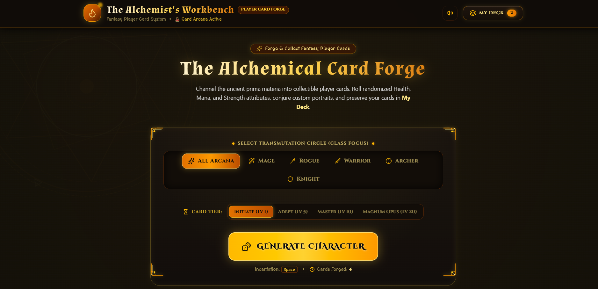
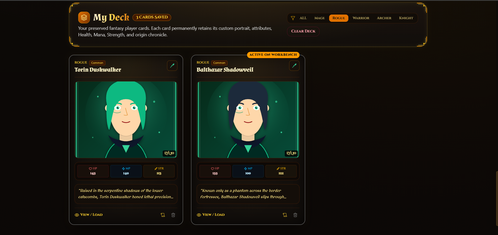

#  Fantasy Character Generator

<p align="center">
  
  
  
</p>

<h3 align="center">Create. Imagine. Bring Your Fantasy Characters to Life.</h3>

<p align="center">
  An AI-powered fantasy character creation experience that transforms creative ideas into unique characters, portraits, backstories, and collectible player cards.
</p>

<p align="center">
  <a href="https://ai.studio/apps/a3112e20-031e-4d4f-9d4f-f01124188d9b">View AI Studio App</a> •
  <a href="#features">Features</a> •
  <a href="#getting-started">Getting Started</a>
</p>

---

##  About the Project

**Fantasy Character Generator** is an interactive AI-powered application built using **Google AI Studio and Gemini**.

It allows users to generate imaginative fantasy characters with unique identities, AI-generated portraits, original backstories, and player statistics.

The application combines generative AI with an immersive fantasy-themed interface, creating an engaging experience for fantasy enthusiasts and creative storytellers.

##  Features

| Feature | Description |
|---|---|
|  Character Generation | Create unique fantasy characters and classes. |
|  AI Portrait Generation | Generate visual portraits for characters. |
|  Portrait Regeneration | Explore alternative character appearances. |
|  Backstory Generation | Generate creative fantasy origin stories. |
|  Character Statistics | View Health, Mana, and Strength attributes. |
|  Character Deck | Save and manage generated characters. |
|  Fantasy UI | Explore an ancient alchemist-inspired interface. |

## 📸 Application Preview

### 🏠 Homepage



### 🧙 Generated Fantasy Character


##  Technology Stack

| Technology | Purpose |
|---|---|
| Google AI Studio | AI-powered application development |
| Google Gemini | Generative AI capabilities |
| React | User interface |
| TypeScript | Application development |
| CSS | Interface styling |
| Git & GitHub | Version control and project hosting |

##  Getting Started

### Prerequisites

Make sure you have installed:

- Node.js
- npm
- Git

### Installation

<<<<<<< HEAD
**1. Clone the repository**
=======
Clone the repository:
>>>>>>> f45cf18 (Prepare project for production deployment)

```bash
git clone https://github.com/darshanpvt-creator/fantasy-character-generator.git
```

<<<<<<< HEAD
**2. Navigate to the project folder**
=======
Navigate to the project directory:
>>>>>>> f45cf18 (Prepare project for production deployment)

```bash
cd fantasy-character-generator
```

<<<<<<< HEAD
**3. Install dependencies**
=======
Install dependencies:
>>>>>>> f45cf18 (Prepare project for production deployment)

```bash
npm install
```

<<<<<<< HEAD
**4. Start the application**
=======
Start the development server:
>>>>>>> f45cf18 (Prepare project for production deployment)

```bash
npm run dev
```

<<<<<<< HEAD
Open the local development URL displayed in your terminal.

##  Project Highlights

- Built through AI-assisted application generation using natural-language prompts.
- Combines AI-generated text and character portraits.
- Provides character statistics and a personal character collection.
- Features a custom fantasy-inspired user interface.

##  Future Enhancements

- Expand character races and classes.
- Introduce additional character attributes.
- Add character search, filtering, and sorting.
- Implement persistent cloud-based character storage.
- Support downloadable character cards.

##  Developer
=======
Open the local URL displayed in your terminal.

## Project Highlights

- Developed an interactive application through natural-language prompting.
- Integrated AI-powered text and image generation capabilities.
- Implemented character attributes and a personal character collection.
- Designed an immersive fantasy-themed user interface.

## Future Improvements

- Add more character races and classes.
- Introduce Intelligence and Charisma attributes.
- Add character filtering and sorting.
- Implement persistent cloud-based character storage.
- Add downloadable character cards.

## Developer
>>>>>>> f45cf18 (Prepare project for production deployment)

**DARSHAN G**

Computer Science Engineering Student

<<<<<<< HEAD
[GitHub Profile](https://github.com/darshanpvt-creator)

[Project Repository](https://github.com/darshanpvt-creator/fantasy-character-generator)
=======
GitHub: [@darshanpvt-creator](https://github.com/darshanpvt-creator)
>>>>>>> f45cf18 (Prepare project for production deployment)

---

<p align="center">
<<<<<<< HEAD
  <strong>Built with Google AI Studio & Gemini</strong>
  <br/>
  <sub>Turning imagination into interactive experiences.</sub>
</p>
=======
  Built with Google AI Studio and Gemini.
</p>
>>>>>>> f45cf18 (Prepare project for production deployment)
